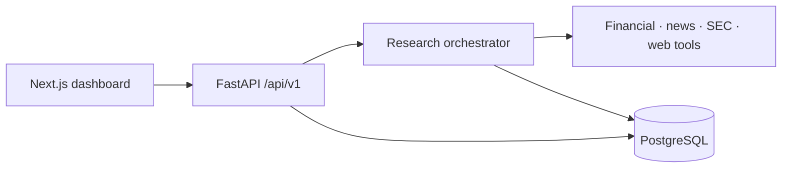

# AlphaAgent

An autonomous equity-research workspace that pairs a Bloomberg-inspired dashboard with a tool-driven, multi-agent research workflow. AlphaAgent will turn a company query into an auditable research report: plan, data collection, analysis, risk assessment, investment debate, and recommendation.

> **Status:** Milestone 1 — platform foundation. The dashboard currently uses representative data while the agent workflow is introduced incrementally in later milestones.

## Architecture



## Stack

- **Frontend:** Next.js 15, TypeScript, Tailwind CSS, TanStack Query, Recharts, Framer Motion
- **Backend:** FastAPI, Python 3.12, SQLAlchemy, Alembic, Pydantic Settings
- **Data:** PostgreSQL
- **Quality:** pytest, Vitest, Playwright, Ruff, MyPy
- **Deployment:** Docker Compose locally; Railway (API) and Vercel (web) in production

## Repository layout

```text
backend/       FastAPI application, domain modules, migrations, tests
frontend/      Next.js application, UI components, API client, browser tests
docs/          Architecture decisions and operational documentation
docker/        Container build configuration
scripts/       Development and maintenance scripts
tests/         Cross-service test assets
```

## Run locally

1. Copy `.env.example` to `.env` and set secrets as required.
2. Start infrastructure: `docker compose up --build`.
3. Open `http://localhost:3000`; API docs are at `http://localhost:8000/docs`.

For individual services:

```bash
cd backend && uv sync --extra dev && uv run uvicorn app.main:app --reload
cd frontend && npm install && npm run dev
```

## Milestones

1. **Foundation (current):** monorepo, FastAPI and Next.js shells, local containers, quality tooling.
2. Research-session domain model and streaming orchestration contract.
3. Tool adapters plus profile, financial, filing, news, and sentiment agents.
4. Valuation, risk, investment committee, persisted reports, and exports.
5. Production hardening, observability, deployment, and end-to-end testing.

## Screenshots

_Dashboard screenshots will be added as the research experience becomes interactive._

## Deployment

Deploy `backend` to Railway with a managed PostgreSQL database and deploy `frontend` to Vercel. Configure `NEXT_PUBLIC_API_URL`, `DATABASE_URL`, and `OPENAI_API_KEY` in the respective environments.

## Future improvements

- SEC EDGAR and market-data provider adapters with source citations
- User authentication, portfolios, scheduled monitoring, and alerts
- Evaluation datasets for agent/tool reliability
- Background-job queue and tracing

## Resume bullet

Built **AlphaAgent**, a tool-driven multi-agent equity research platform using FastAPI, Next.js, PostgreSQL, and streaming task telemetry to turn company queries into auditable financial research and investment recommendations.
