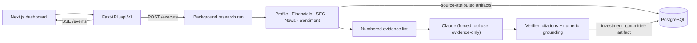

# AlphaAgent

[](https://github.com/DhritiSoni4/AI-Investment-Research-Agent/actions/workflows/ci.yml)

An equity-research platform where **every claim an LLM makes must cite evidence, and code checks it**. Specialist agents collect primary-source data (Yahoo Finance, SEC EDGAR); a Claude-backed "investment committee" writes a bull/bear/risk report; a deterministic verifier drops any claim whose citation is invalid or whose numbers the cited evidence does not support. A separate quant package provides a look-ahead-safe backtester to test signals honestly.

> **Status:** backend pipeline, grounding verifier, quant engine and CI are working. The dashboard UI still shows representative data and is not yet wired to live results. Educational project, **not investment advice**.

## How it works



### Grounded report generation

1. Tool output is flattened into numbered, source-linked facts (`[3] financial_analysis.revenue = 130.50B`).
2. Claude receives only that list and must return structured claims with evidence IDs.
3. `verify_report` removes claims that cite nothing, cite unknown IDs, or contain a number (e.g. `$130.5B`, `25%`) not supported by the *cited* evidence within 1%.
4. The artifact stores the surviving claims, the dropped ones with reasons, and a `grounding_rate`.

See [`report_synthesis.py`](backend/app/services/report_synthesis.py) and its [tests](backend/tests/test_report_synthesis.py).

### Quant engine

[`backend/app/quant/`](backend/app/quant) is a pure, deterministic package (NumPy only):

- Vectorized backtester with transaction costs, slippage and a mandatory signal lag (>= 1 period), so a signal can never earn the return it was based on.
- Sharpe, Sortino, max drawdown, annualized return/volatility, alpha/beta vs a benchmark.
- Walk-forward train/test windows that never overlap or leak.
- Property-based tests (Hypothesis) assert no look-ahead, monotonic cost impact and bounded drawdown.

## Stack

- **Frontend:** Next.js 15, TypeScript, Tailwind CSS, TanStack Query, Recharts
- **Backend:** FastAPI, Python 3.12, SQLAlchemy, Alembic, Pydantic, Anthropic SDK, NumPy
- **Data:** PostgreSQL (SQLite in tests)
- **Quality:** pytest + Hypothesis, Vitest, Playwright, Ruff, strict MyPy, GitHub Actions CI

## Run locally

```bash
cp .env.example .env        # add ANTHROPIC_API_KEY to enable the committee report
docker compose up --build   # dashboard :3000, API docs :8000/docs
```

Without `ANTHROPIC_API_KEY` the committee step is skipped and the specialist agents still run.

Individual services:

```bash
cd backend && uv sync --extra dev && uv run uvicorn app.main:app --reload
cd frontend && npm install && npm run dev
```

Checks (same as CI):

```bash
cd backend && uv run ruff check . && uv run ruff format --check . && uv run mypy && uv run pytest
cd frontend && npm run typecheck && npm test && npm run build
```

## Repository layout

```text
backend/app/api/         FastAPI routes (REST + SSE event stream)
backend/app/services/    Research execution, report synthesis and verification
backend/app/quant/       Backtester, metrics, walk-forward windows
backend/app/infrastructure/  Database and Yahoo Finance / SEC EDGAR adapters
frontend/                Next.js dashboard
docs/                    Architecture notes
```

## Limitations

- Sentiment is a deterministic headline-keyword classifier, not analyst sentiment.
- The grounding check verifies numbers and citations, not reasoning quality or qualitative claims.
- Yahoo Finance endpoints are unofficial and can change or rate-limit.
- Backtests are not yet connected to LLM ratings; no performance claim is made.
- Dashboard is not yet connected to live research results; no deployed demo or screenshots yet.

## Roadmap

- Wire the dashboard to sessions, the SSE stream and the committee report
- Evaluate LLM ratings against a momentum baseline with walk-forward backtests
- Deploy (Railway API, Vercel web) and add a demo recording
- Authentication, portfolios, background job queue and tracing
